Visual Study Timer | Digital Electronics & PCB Design

Project Overview

The Visual Study Timer is an electronic countdown system designed to visualize the progression of a study session through sequential LED indicators.

The project uses a 555 Timer IC to generate clock pulses and a CD4017 Decade Counter to activate LEDs sequentially, providing a simple visual representation of elapsed study time.

The project combines circuit simulation, electronic design, hardware prototyping, and PCB development.

Project Objectives

* Design a visual countdown system using digital electronics.
* Apply timing concepts using the 555 Timer IC.
* Implement sequential LED control using the CD4017 Decade Counter.
* Develop and simulate an electronic circuit.
* Build a physical breadboard prototype.
* Create a PCB layout and 3D board visualization.

Main Components

* NE555 Timer IC
* CD4017 Decade Counter IC
* 10 LEDs
* Resistors
* Capacitors
* Push Button
* Buzzer
* Power Supply
* Breadboard and jumper wires

System Working Principle

1. The 555 Timer generates periodic clock pulses.
2. The CD4017 receives the clock pulses.
3. The counter activates its output pins sequentially.
4. LEDs light up one after another to represent study session progress.
5. The buzzer provides an audio alert as part of the circuit design.

Design & Development

The project development included:

* Circuit design and simulation using Tinkercad Circuits.
* Electronic schematic development.
* Physical breadboard prototyping.
* PCB layout design.
* 3D PCB visualization.

Tools & Technologies

* Autodesk Tinkercad Circuits
* NE555 Timer
* CD4017 Decade Counter
* EasyEDA
* Electronic Circuit Design
* Digital Electronics
* PCB Design

Project Documentation

This repository includes circuit simulations, schematic diagrams, physical prototype photographs, PCB layout designs, and 3D PCB visualizations.

Project Status

Academic electronics project covering circuit simulation, physical prototyping, and PCB design.

Skills Developed

* Electronic Circuit Design
* Digital Electronics
* Circuit Simulation
* Hardware Prototyping
* PCB Design
* Technical Documentation

## Project Gallery

### Circuit Simulation

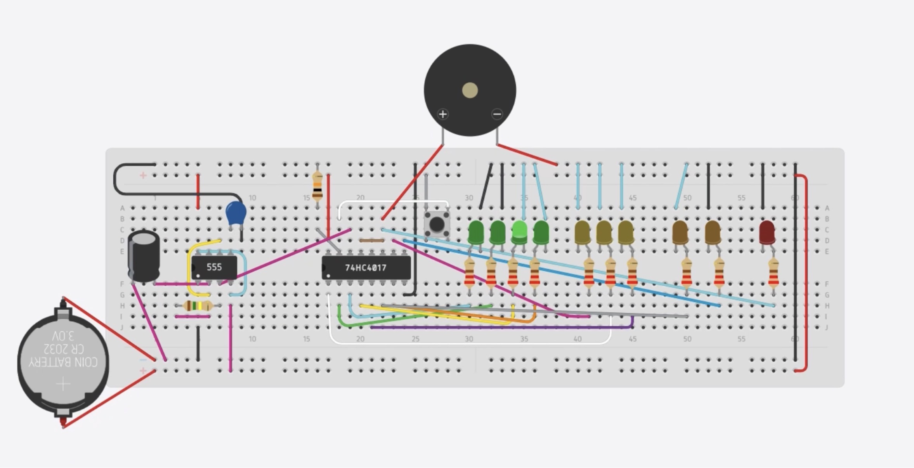

### Physical Prototype

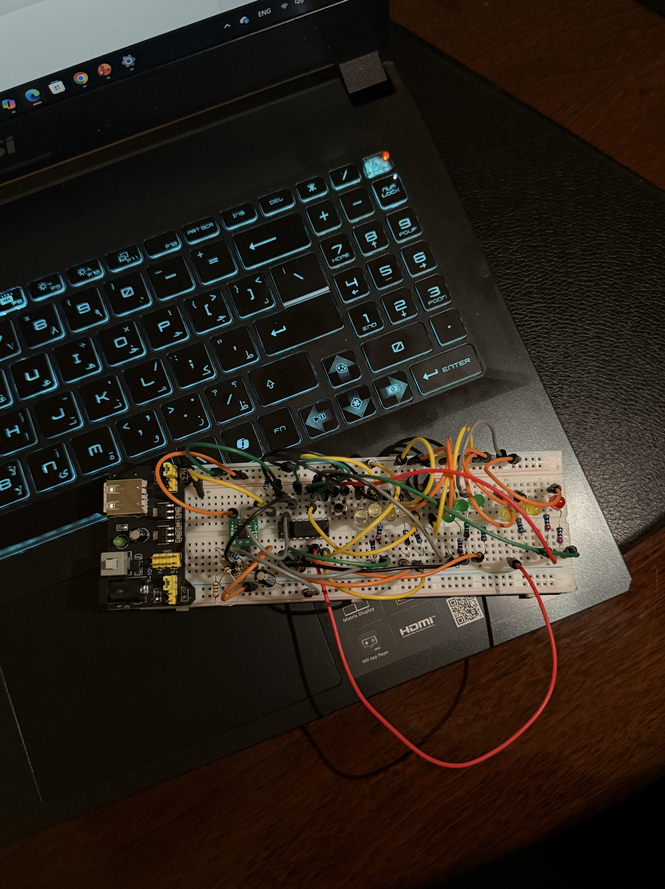

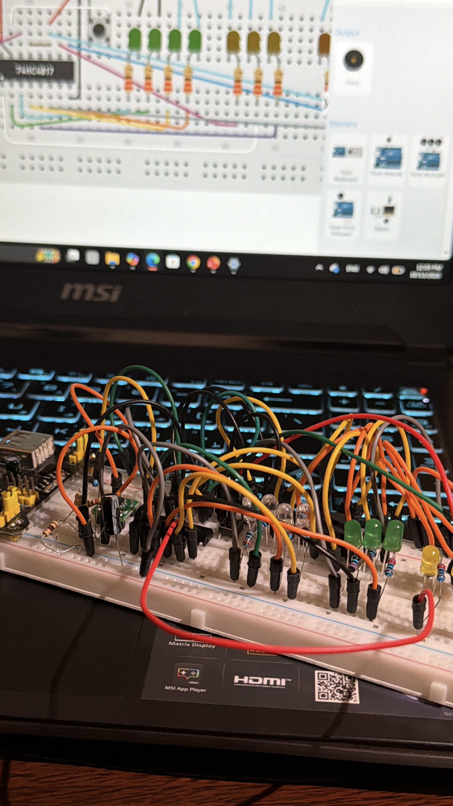

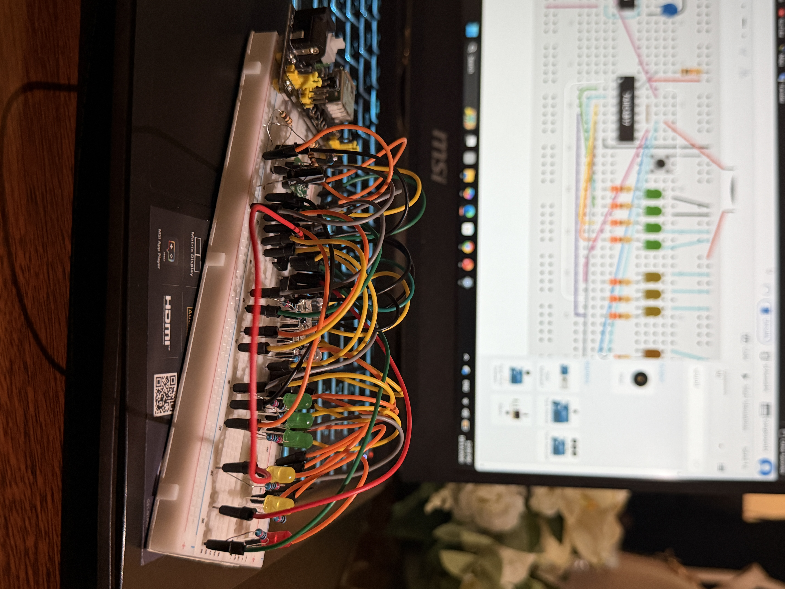

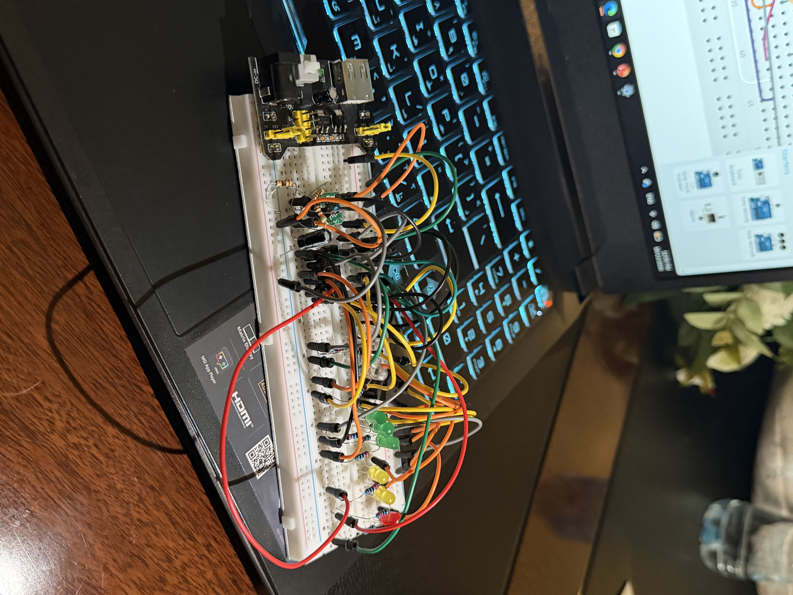

### Circuit Schematic

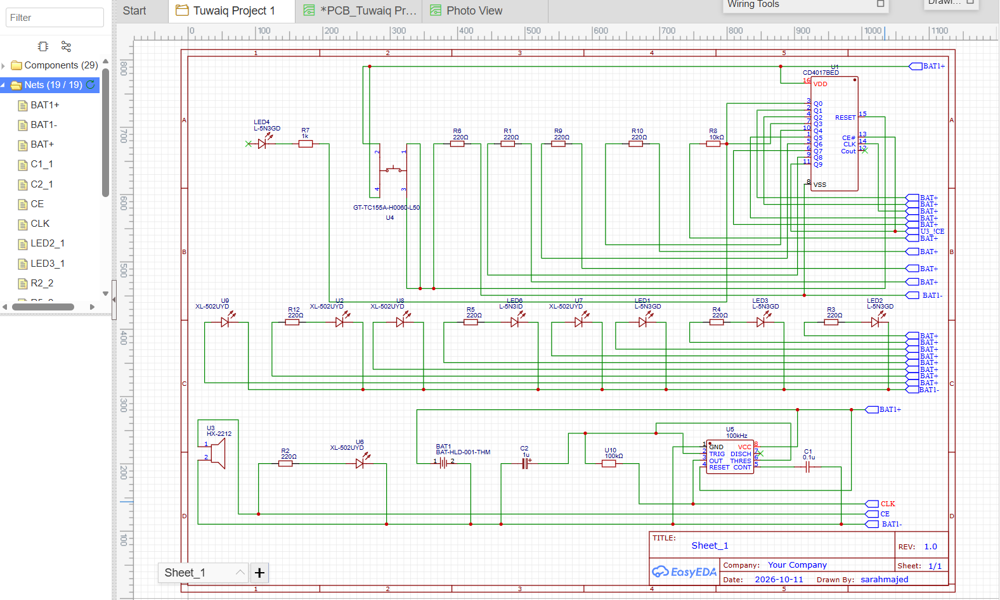

### PCB Design

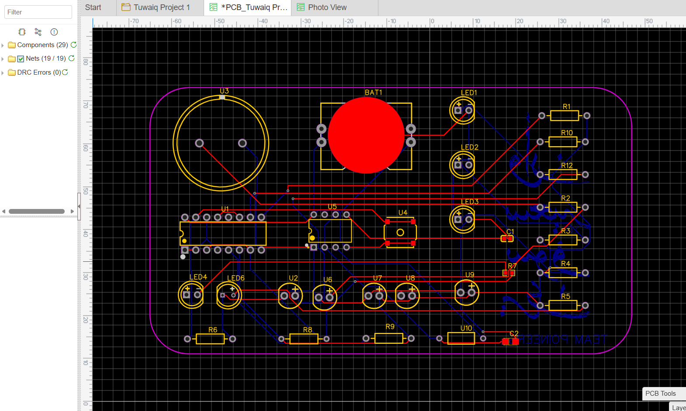

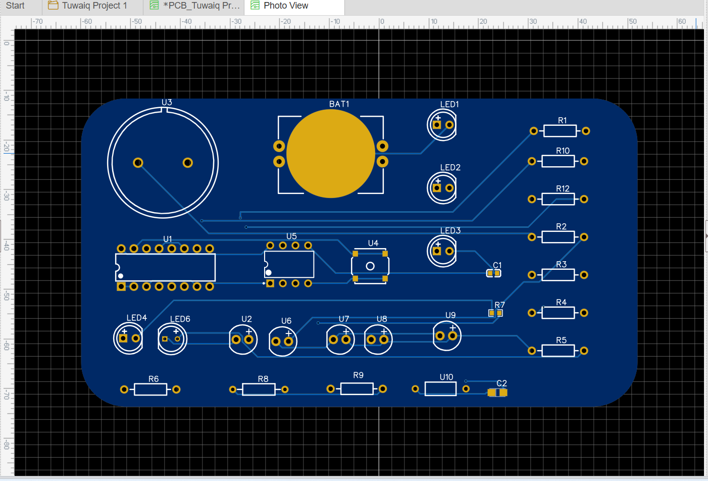

### 3D PCB View

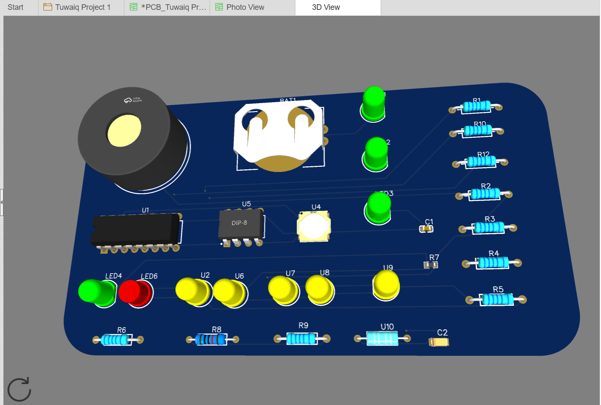

### PCB Bottom View

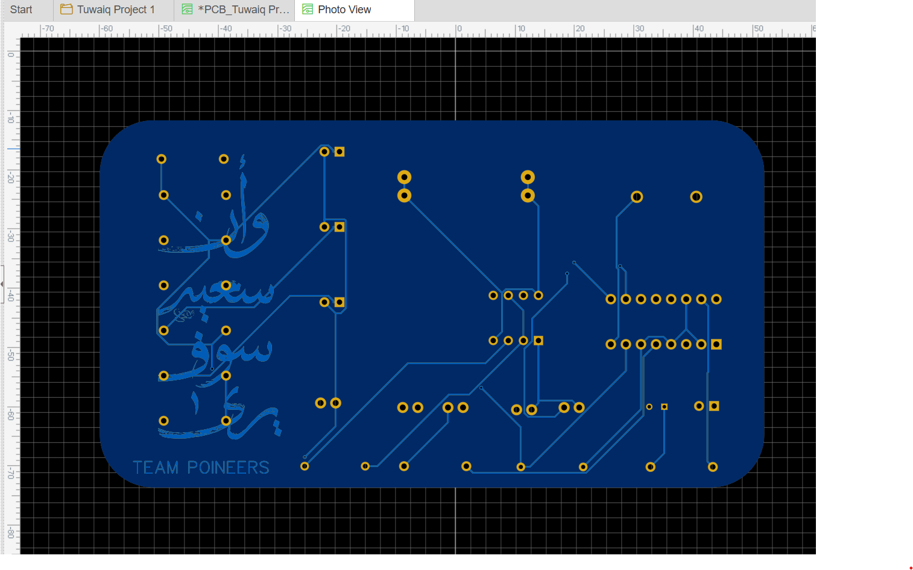

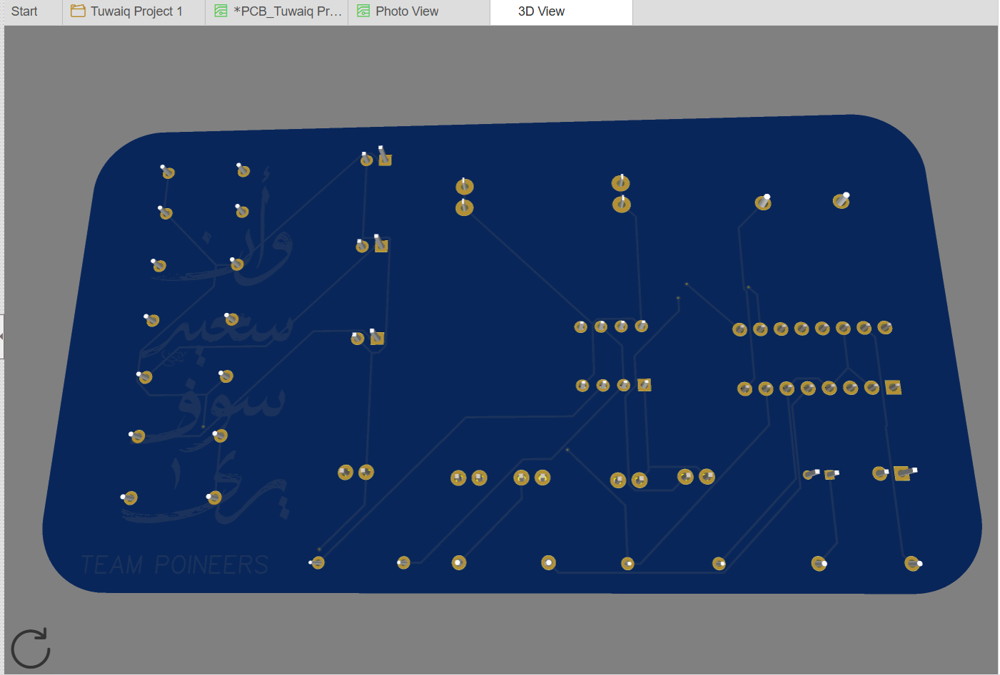

## Project Demonstration

Watch the circuit simulation video:

[Visual Study Timer – Simulation Demo](videos/visual-study-timer-simulation.mp4)
